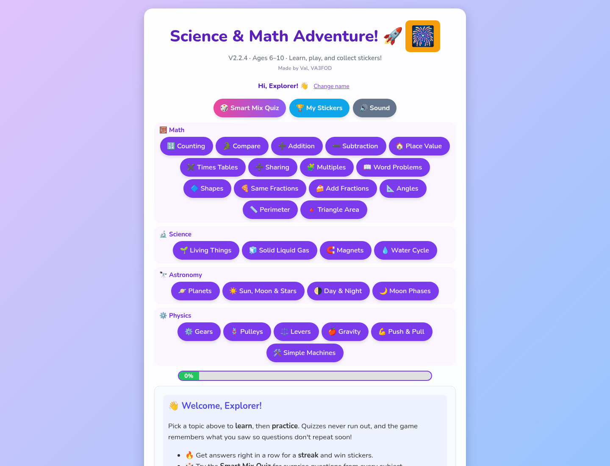
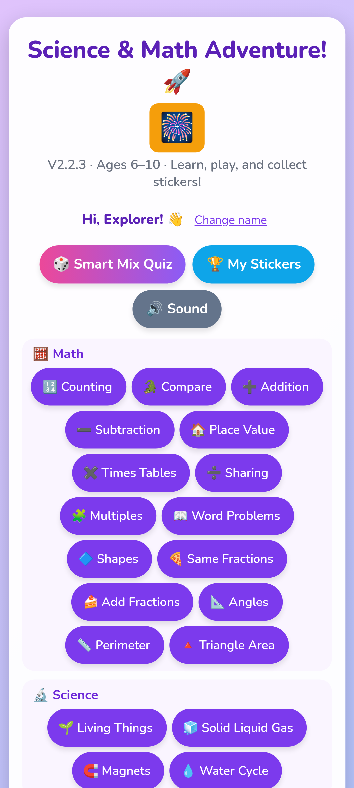
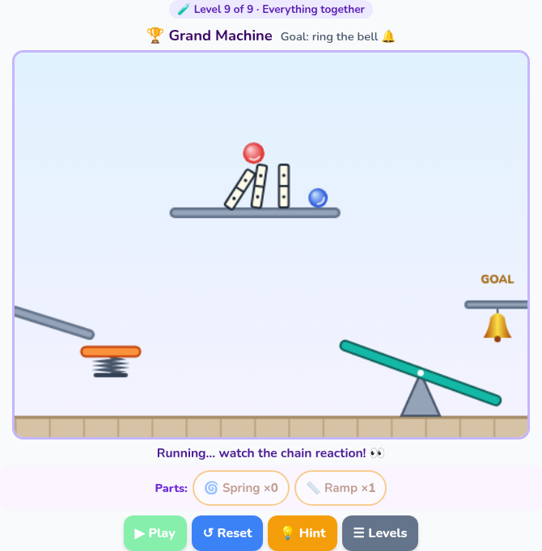
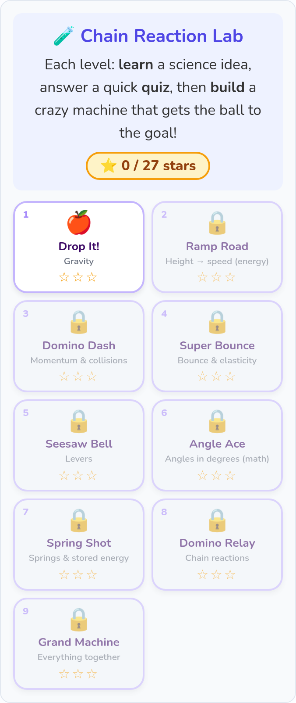
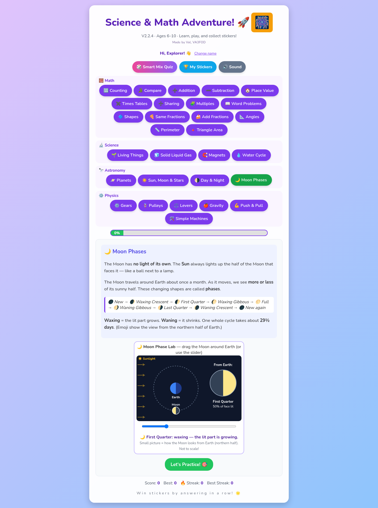

# Science & Math Adventure — by Val, VA3FOD

Science & Math Adventure is an interactive science and math learning game for kids (ages 6–10). This is a single-file web app you can open in any browser, on your phone, tablet, or computer, including offline.

[Play now on GitHub Pages](https://va3fod.github.io/Science-Math-Adventure/)

## Features

- **Adaptive difficulty** that grows as you get answers right
- **Math:** counting, comparing numbers, addition, subtraction, place value, multiplication, division, multiples, word problems, shapes, fractions, angles, perimeter, and triangle area
- **Science and space:** living things, states of matter, magnets, the water cycle, planets, sun/moon/stars, day and night, and a **Moon Phases** lab
- **Physics labs:** gears, pulleys, levers, gravity, forces, and simple machines
- **New in v2.3.0 — Chain Reaction Lab:** 9 physics-puzzle levels. Each one is *learn → quiz → build → reflect*: a short lesson, a quick quiz that unlocks the build stage, then place ramps, bouncy pads and springs so a ball sets off a chain reaction (dominoes, seesaws, bells and baskets). Earn up to 3 stars per level. *(v2.3.1: lab quiz answers and finished builds now count on the Score / Streak bar.)* Covers gravity, height → speed (energy), momentum, bounce and elasticity, levers, angles in degrees, springs, and chain reactions
- Enter a **player name** (saved only in this browser)
- **Auto-next** after a correct answer
- **Sounds** with a mute button
- Stickers, streaks, a Smart Mix Quiz, and fireworks
- Progress is saved **locally in the browser only** — nothing is uploaded
- A tiny, anonymous **visit counter** (no cookies, no personal data) is shown in the credit line

## How to use

- Open it in your browser on a phone, tablet, or computer: [https://va3fod.github.io/Science-Math-Adventure/](https://va3fod.github.io/Science-Math-Adventure/)
- Or download [`index.html`](./index.html) and open it locally — no install, and it works offline once downloaded.

The newest build is always attached to the [latest release](https://github.com/va3fod/Science-Math-Adventure/releases/latest) (currently v2.3.1, as `Science_Math_Adventure_V2.3.1.html`).

## Screenshots

Welcome screen on a computer:

Welcome screen on a phone:

Chain Reaction Lab (Grand Machine level, mid-run):

Chain Reaction Lab level select on a phone:

Moon Phases lab:

## Credit

Made by Val, VA3FOD.

## Source and rights

All rights reserved.
